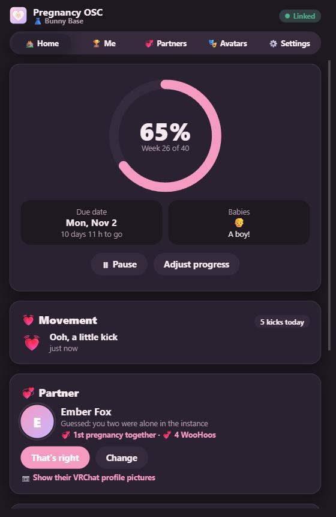
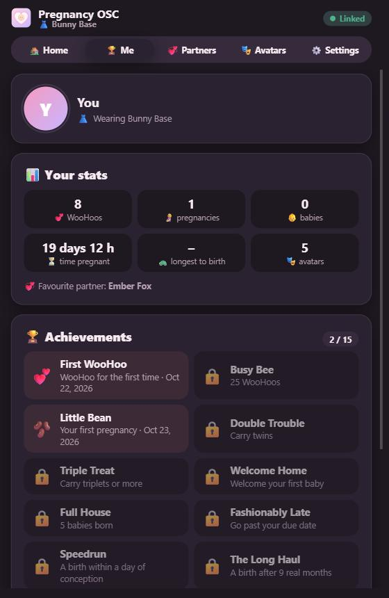
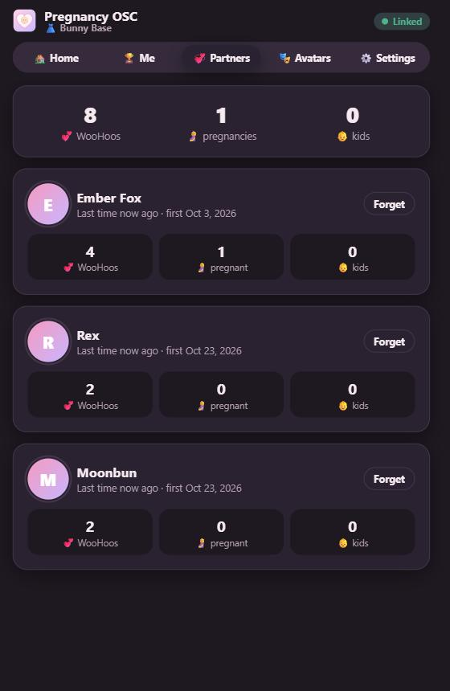
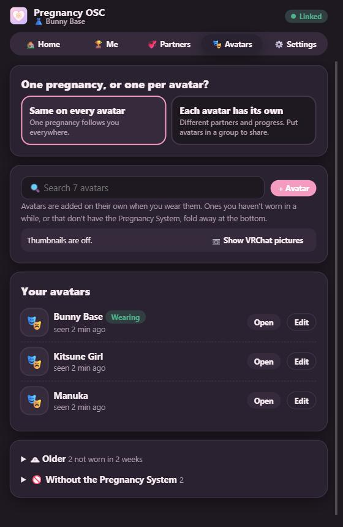
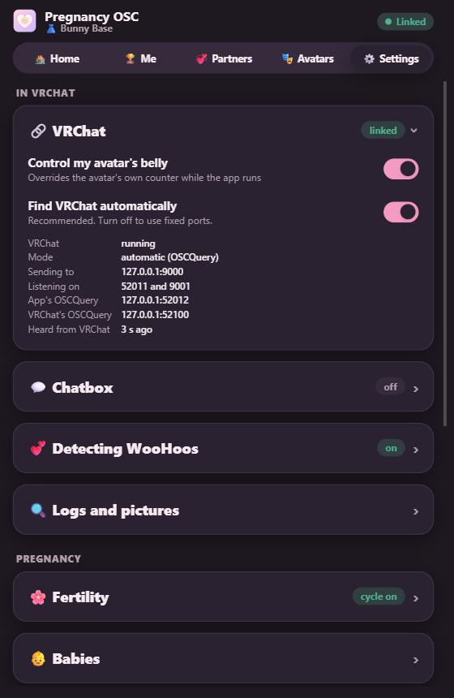

# Pregnancy OSC

A small, cute desktop app that runs your avatar's pregnancy from outside VRChat:

1. **Overrides the avatar's own counter.** The app writes the belly size over OSC, so it's in charge while it runs.
2. **Speed and progress.** See the week, percent and time left. Pick real time, 1 day = 1 week, 1 hour = 1 week or a custom length. Pause, or jump to a week.
3. **Partner.** If it was just the two of you in the instance, the app guesses them. Otherwise it lists who was in the instance at conception, and you pick (or type a name).

That's it for now. More gets added step by step. Built but parked features (x-ray belly, species, Gene Lab, scans, journal, avatar profiles) are in [later/](later/README.md).

- **Stack:** Tauri 2 (Rust) + Svelte 5 + TypeScript
- **Platforms:** Windows now; Linux and Flatpak ready (not tested on Linux yet)

The pregnancy is stored as a **start time**, never a current size, so it's right whenever you open the app.

<table>
  <tr>
    <td></td>
    <td></td>
    <td></td>
  </tr>
  <tr>
    <td align="center"><b>Home</b></td>
    <td align="center"><b>Me</b></td>
    <td align="center"><b>Partners</b></td>
  </tr>
  <tr>
    <td></td>
    <td></td>
    <td></td>
  </tr>
  <tr>
    <td align="center"><b>Avatars</b></td>
    <td align="center"><b>Settings</b></td>
    <td></td>
  </tr>
</table>

---

## Install and run

### Windows (installer)
Download the `..._x64-setup.exe` from the newest [release](https://github.com/CukroTheOtter/pregnancy-osc/releases) and run it. It installs for your user only (no admin needed). After that the app updates itself: it checks at start-up, and **Settings > Updates** has an **Update now** button.

### Build it yourself

You need [Rust](https://rustup.rs), [Node.js LTS](https://nodejs.org) and, on Windows, the Visual Studio C++ Build Tools.

```bash
npm install
npx tauri dev      # run the app with live reload
npx tauri build --config src-tauri/tauri.local.json    # release build + installer
```

Linux also needs: `libwebkit2gtk-4.1-dev libayatana-appindicator3-dev librsvg2-dev build-essential`.

### Flatpak (Linux)
```bash
npx tauri build --bundles deb
flatpak-builder --user --install --force-clean build-dir packaging/flatpak/com.pregsys.companion.yml
flatpak run com.pregsys.companion
```
The manifest grants: network (OSC/OSCQuery), read-only access to the VRChat folder in the Proton prefix, SteamVR's config folder (for "Start with SteamVR") and the autostart folder. If your Steam lives elsewhere, pick the log folder in **Settings > VRChat logs**.

### Preview the UI in a browser
`npm run dev` and open http://localhost:1420. It uses a built-in demo backend (no OSC, no log reading), so you can try every screen.

---

## Connect to VRChat

1. In VRChat: Action Menu > Options > OSC > **Enabled**.
2. Start the app. It finds VRChat automatically (OSCQuery) and shows **VRChat linked**.
3. Your avatar needs a synced float for the belly. The default name is `Pregnancy/Stage`. If yours is different, change it in **Settings > OSC parameter names**. No code changes needed.

Full list of what the avatar can provide, the sync cost, and how the "app active" flag and heartbeat work: **[docs/osc-parameters.md](docs/osc-parameters.md)**.

**Minimum:** one synced float (8 bits). **Everything:** 38 synced bits. The app-active flag and heartbeat are local and free.

---

## How it behaves

| Situation | What happens |
|---|---|
| VRChat not running | The app idles quietly. No OSC, no network. |
| VRChat starts | Links up, snaps the belly to the app's timeline. |
| Avatar switch | Snaps the belly on the new avatar. |
| Pregnancy paused | Lets go of the belly and extra size, so you can set them in-game. |
| Chatbox on (Settings) | Shows your own message in the chatbox when a pregnancy starts, pauses, resumes, stops, and more, then clears it. Can also always show your pregnancy status (and partner). |
| A WooHoo (SPS sockets, see Settings) | Starts the grace period (or a pregnancy right away with Fertility off) and guesses the partner from the log. |
| Exactly one other person in the instance, nobody came or went for 10 min | Partner shown as **Guessed**, with confirm or change. |
| More people, or joins/leaves | Partner **Unknown**, with a list of who was in that instance to pick from. |
| App closes | Sends the final belly value and releases the app-active flag. |

---

## Privacy

- VRChat logs are read **on this computer only** and never uploaded. Only display names, user IDs and avatar names are kept.
- No VRChat login, no accounts, no analytics. Normally the only network traffic is OSC/OSCQuery to VRChat on your own machine, plus an update check against this project's GitHub releases at start-up.
- **Optional:** "Show VRChat profile pictures" (off by default) loads each partner's public profile page on vrchat.com once, to get the same picture Discord shows in link previews. Pictures are shrunk and cached on your PC for a week.
- Data lives in your user data folder , with a daily backup kept for a week.

---

## Project layout

```
app/
  config/osc-parameters.json   default parameter names (copied to your settings folder on first run)
  docs/osc-parameters.md       avatar-side parameter list and budget
  crates/pregsys-core/         pure logic + tests: timeline, mapping, stage, driver, storage, log parser
  crates/pregsys-osc/          OSC send/receive, OSCQuery advertise + discovery
  crates/belly-cli/            command-line tool to test OSC by hand
  src-tauri/                   the desktop app (engine loop, tray, autostart, SteamVR, commands)
  src/                         the UI (Svelte): views/Main.svelte, views/Settings.svelte
  later/                       parked features, ready to bring back
  packaging/flatpak/           Flatpak manifest, desktop file, metainfo
```

## Tests

```bash
cargo test --workspace   # Rust: timeline, mapping, stage, driver, storage, log parser (+ Windows/Proton fixtures), OSC
npm test                 # TypeScript: timeline
npm run check            # type check the UI
```

### Debug mode (test in VRChat)
Tap the **Pregnancy OSC** title 5 times. A 🛠 Debug section appears at the bottom of Settings: pretend a WooHoo (random, pregnant, or not), end the grace period now, jump the cycle to a day or the pregnancy to a week, and see live readouts of what's being sent. Tap 5 times again (or "Turn off") to hide it.

### Test OSC by hand (`belly-cli`)
```bash
cargo run -p belly-cli -- --stage 0.5               # half belly
cargo run -p belly-cli -- --sweep 60                # grow 0 to full in a minute
cargo run -p belly-cli -- --sweep 60 --app-active   # also hold the app-active flag + heartbeat
cargo run -p belly-cli -- --query                   # list the avatar's parameters (OSCQuery)
cargo run -p belly-cli -- --listen 10               # print what VRChat sends
```

---

## Manual test checklist

**VRChat link** (VRChat running, OSC on)
- [ ] The top shows "Linked" within a few seconds.
- [ ] Start a pregnancy at "1 hour = 1 week" and use Adjust progress to jump to week 20: the belly jumps to about half.
- [ ] Move the belly in the VRChat menu: the app puts it back within a second (it re-sends the belly every second).
- [ ] Quit the app: the belly stays where it was (the avatar's own counter carries on).
- [ ] Close VRChat: the app goes back to "Waiting for VRChat".

**Speed and progress**
- [ ] Changing speed keeps the percent the same; only the time left changes.
- [ ] Pause, wait, resume: progress didn't move while paused.
- [ ] Close the app for a while and reopen: progress has moved on correctly.

**Partner**
- [ ] Alone with one person for 10 minutes, then conception in-game: a pregnancy starts and they show as "Guessed". "That's right" confirms.
- [ ] With 2+ people: the list shows only people from that instance.
- [ ] "Someone else" with a typed name works. "Set to unknown" clears it.

**Startup**
- [ ] "Start when I log in" + "Start hidden in the tray" works.
- [ ] "Start with SteamVR" works (if not, enable it in SteamVR Settings > Startup / Shutdown > Choose Startup Overlay Apps).
- [ ] Launching the app twice focuses the existing window.

## What still needs testing

These couldn't be checked without real hardware or software:
- **In VRChat:** OSCQuery discovery, parameter writes, `/avatar/change`, and in-game conception.
- **Real VRChat logs:** the parser is built from known log lines plus made-up samples. Please send a few real lines (joins, leaves, avatar switches) from Windows and Proton so the fixtures can match reality.
- **SteamVR autostart:** the manifest registration is standard, but where SteamVR stores the "autolaunch" setting isn't documented. There's a manual fallback (see the checklist).
- **Linux and Flatpak:** not built or run yet. The tray needs libayatana-appindicator, which the Flatpak runtime may not include; without it the app still works (closing the window quits).
